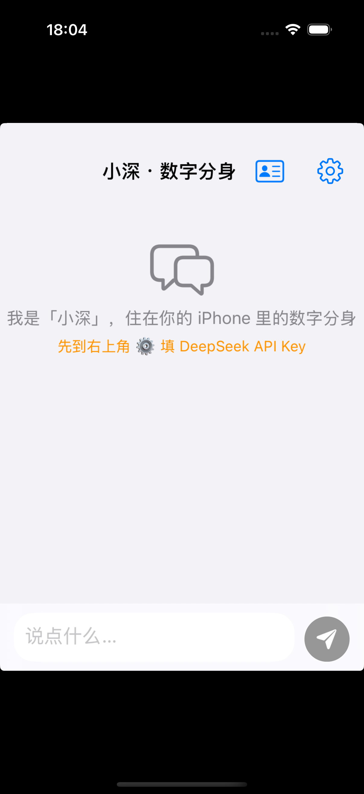

# 分身（FenShen）— iPhone 上的「QQ 数字分身」

把 `~/Documents/deepseek-harness/qq` 的核心能力搬进一个原生 iOS App：
**人设大脑 + DeepSeek 流式对话 + 长期记忆（滚动摘要）+ 联网搜索工具**。
QQ/NapCat 那一层在 iOS 上无法复刻（那是 Linux QQ 容器），所以这个 App 直接作为「她」的对话端。



## 功能对照（qq 项目 → 本 App）

| qq 项目 | 本 App |
| --- | --- |
| `bridge/persona.md` 人设 | `PersonaStore`：设置 → 人设 子菜单内编辑 |
| `src/model/deepseek.js`（关思考） | `DeepSeekClient`：SSE 流式 + 异常/截断检测（不自动重试，避免重复输出和费用） |
| `src/model/tool-loop.js` 工具循环 | `ask()`：最多 3 轮 function calling |
| `src/tools/websearch.js` 联网搜索 | `WebSearchTool`：DuckDuckGo 免费无 key |
| `src/store/memory.js` 记忆 | `MemoryStore`：逐字窗口 + 滚动摘要 + 原子写（tmp+rename，坏文件留档） |
| `src/core/pipeline.js` 流水线 | `Pipeline`：收消息 → 记忆 → 模型(可调工具) → 清洗 → 落盘 |
| `src/config/schema.js` 配置 | `SettingsStore`：设置页（key / 模型 / 温度 / 窗口长度 / 搜索开关） |
| `src/core/usage.js` 用量 | `UsageStore` + 「用量信息」页（设置页置顶，累计/每日 token 统计，落盘 usage.json） |

## 使用

1. 用 Xcode 打开 `FenShen.xcodeproj`，插上 iPhone，Signing & Capabilities 里选你的个人 Team，⌘R 装到手机（免费账号 7 天有效期）。
2. 首次启动 → 右上角 ⚙️ → 「接口 → DeepSeek API」子菜单 → 填 API Key（可在里面点「发送一条测试消息」验证连通）。
3. 开聊。问她时事她会自己调 `web_search` 搜完再答；重启 App 记忆还在（存在 App Documents/memory/）。
   输入框左侧还有 **📷 图片** 和 **📎 文件** 按钮，全部按 DeepSeek 官方文档直传：
   - 图片（JPEG/PNG/GIF/WebP）：转 base64 `image_url` 内容块内联发送（`deepseek-flash` 支持图像理解；`v4-pro` 不支持，会给出明确提示）；
   - PDF/Word/PPT：经 Files API 以 `text_recognition` purpose 上传，对话里用 `file_id` 块引用；
   - 纯文本/代码/表格（XLSX）/电子书（EPUB/MOBI）：Files API `user_data` 直传；
   - 其他二进制类型：退回本地纯文本抽取（超 8000 字截断）。
   附件轻量记入记忆（file_id 不落盘），之后仍可追问本轮内容。
4. 设置页置顶还有：**用量信息**（累计/每日 token、估算花费、官方定价）、**充值**（拉起 Safari 收银台 + 微信/支付宝）、**记忆管理**（浏览窗口、编辑长期摘要、导出 JSON、分段清理）、**人设**（编辑她的性格和说话方式）、**聊天背景**（纯色/渐变/相册照片，选图后可拖动+双指缩放裁剪，支持全屏/3:4/1:1/16:9 比例，原图可反复重裁）、**每日日程**（对应桌面端 dsh-daily-schedule：今天/明天时间线编辑，自动生成"她此刻的生活背景"注入每轮对话，她还能用 schedule_adjust / schedule_view 两个工具自己记事和改计划）。；以及**本机信息工具**：日历读写（calendar_read / calendar_create）、提醒事项读写（reminders_read / reminders_create）、备忘录搜索（notes_search，受系统能力限制只能查标题/摘要）。

## 重新生成工程（改了 project.yml 或增删文件后）

```bash
xcodegen generate
```

## 构建/测试命令（本机已验证）

```bash
# 模拟器构建（沙箱外正常 Xcode 环境直接 xcodebuild 即可）
DEVELOPER_DIR=/Applications/Xcode.app/Contents/Developer \
xcodebuild -project FenShen.xcodeproj -scheme FenShen \
  -destination 'generic/platform=iOS Simulator' ARCHS=arm64 CODE_SIGNING_ALLOWED=NO \
  -derivedDataPath .build/DerivedData build
```

## 离线回归测试

测试使用临时目录、独立 UserDefaults 和模拟网络响应，不需要 API Key，也不调用收费接口。

```bash
xcodegen generate
DEVELOPER_DIR=/Applications/Xcode.app/Contents/Developer \
xcodebuild -project FenShen.xcodeproj -scheme FenShen \
  -destination 'platform=iOS Simulator,name=iPhone 16 Pro,OS=18.6' \
  CODE_SIGNING_ALLOWED=NO -parallel-testing-enabled NO \
  -derivedDataPath .build/DerivedData test
```

模拟器名称和系统版本请按本机已安装的设备调整。

2026-11-15 验证：Xcode 27.2 / iPhone 16 Pro 模拟器（iOS 18.6），应用与测试目标编译成功，34 项测试全部通过（存储 8、附件/裁剪/增量缓冲 9、网络 17）。如果代理执行沙箱阻止 Swift 宏插件启动，应授权在正常 Xcode 环境运行上述命令，不要修改项目设置来禁用安全机制。

### 本轮修复与优化

- 记忆与用量采用支持首次创建的原子写；损坏备份使用唯一名称，避免覆盖旧档。
- 修复记忆管理倒序列表删除错位，以及设置/背景/用量变化不及时刷新的问题。
- 流式回复合并为约 50ms 一次 UI 更新，复用未变化的气泡，取消逐 token 任务和重叠滚动动画。
- 修复流结束后迟到增量可能重复追加的问题；错误或断流不再按成功回复保存。
- 工具严格限制为最多三轮加一次无工具总结；请求直接 Codable 编码，移除多余 JSON 编解码和强制解包。
- 图片后台下采样、背景共享有界解码缓存；修复同文件重裁不刷新、裁剪预览与导出几何不一致。
- PDF 文本足够后停止提取后续页面；纯文本保留完整 UTF-8/二进制校验与 8000 字限制，超大纯文本仍需完整解码。
- 修复搜索结果 JSON 字段类型、特殊字符查询编码及 HTTP 错误处理。

性能收益来自减少刷新/解码/请求等具体工作量；尚未做真机 Instruments 对照，不承诺固定加速比例。

### 2026-11-17 第二节：通话与上传链路

- 修复 iOS 26 语音识别启动路径：`start()` 现在真的安装麦克风 tap 并启动 engine（此前只创建识别器，界面显示「收音中」却永远收不到声音）；启动失败会回滚已建资源。
- 修复旧版识别（iOS < 26）两句就哑：同文 `final` 不再被 partial 去重吞掉，说完一句自动换新识别请求，麦克风与 engine 不重启，可连续多轮；stop 后旧回调不能复活收听。
- 修复挂断后通话被「复活」：启动/回复任务都可取消，旧任务不能再把状态写回 listening；快速重拨会先等旧识别与音频清理完成，旧轮不会覆盖新轮状态。
- 同一时刻只允许一轮回复（同 tick 两个 final 不再并行启动）；本地 TTS 按 utterance 匹配并只结束一次续体，消除重复 resume 崩溃与等待任务泄漏。
- 云端 TTS 中途失败时先清掉本句残余音频再降级本地，正常云→本地切换等前一句播完，避免两路声音重叠。
- `awaitDrained` 改为回调唤醒，不再轮询；每片音频带 token，stop 后迟到回调不会误清新一轮；退出通话时真正停止并释放音频引擎。
- 附件上传改为后台分块写 multipart 临时文件后 `upload(fromFile:)`：不再在主线程额外复制整份附件，临时文件在成功、HTTP 错误、传输错误、取消路径都会清理；文档直接读 URL，不再先整份读入内存。
- 工具调用参数改为字典原位追加，长参数分片到达时不再反复复制已累积字符串。
- 图片 base64 与文本兜底抽取移到后台执行，取消能及时传导到上传/抽取。
- 修复「＋ → 相册」点击无效：相册选择器原先挂在会立即移除的附件面板上，现在挂到常驻视图。

离线回归：73 项测试通过（Keychain 在模拟器测试环境按既有逻辑跳过），覆盖新增的通话竞态、TTS 续体、多轮识别状态与上传清理用例。

## 目录

```
Sources/
  App/FenShenApp.swift      入口 + 全局装配（对应 core-runtime.js）
  Model/DeepSeekClient.swift  DeepSeek API + SSE + 工具调用循环
  Core/Stores.swift         设置 / 人设 / 记忆（原子写 + 损坏恢复）
  Core/Pipeline.swift       对话流水线 + 回复清洗
  Tools/Tools.swift         工具协议 + web_search（DuckDuckGo）
  UI/ChatView.swift         聊天界面（气泡 / 流式打字机）
  UI/SettingsView.swift     设置页 + 人设编辑器
```

## 想继续扩展？

- 多会话（像 qq 项目一人/一群一个记忆文件）：把 `MemoryStore` 按 contact key 实例化多个即可，存储层已按文件组织。
- 推送：接入 APNs 或复用 qq 项目的官方 bot 通道（`bin/notify.js`）给手机发提醒。
- 语音：加 Speech 框架做语音输入，AVSpeechSynthesizer 朗读回复。
